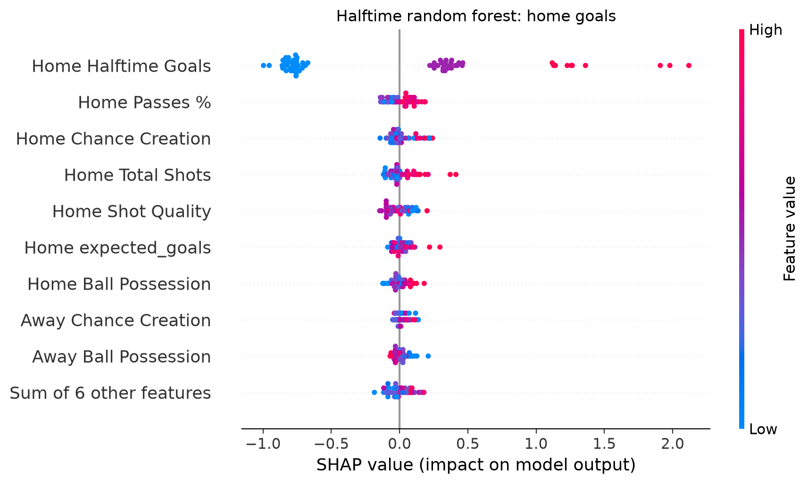
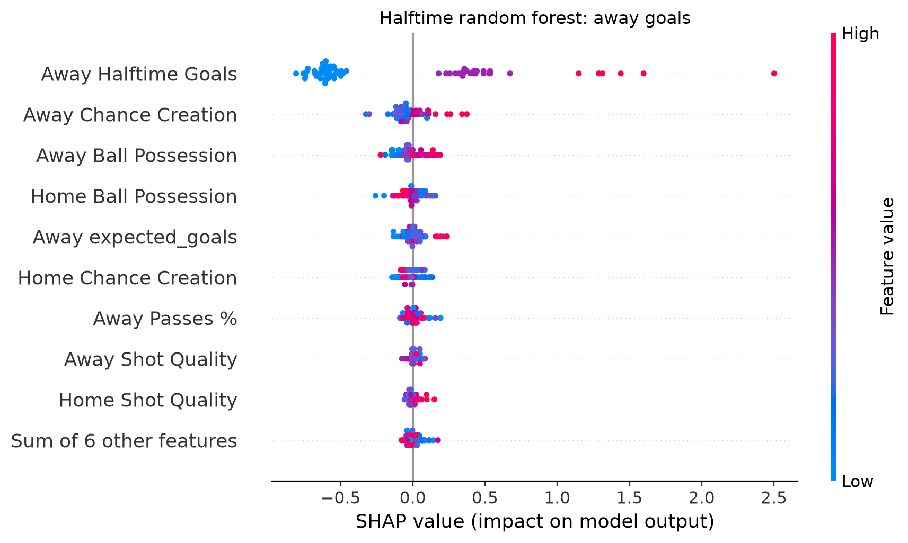
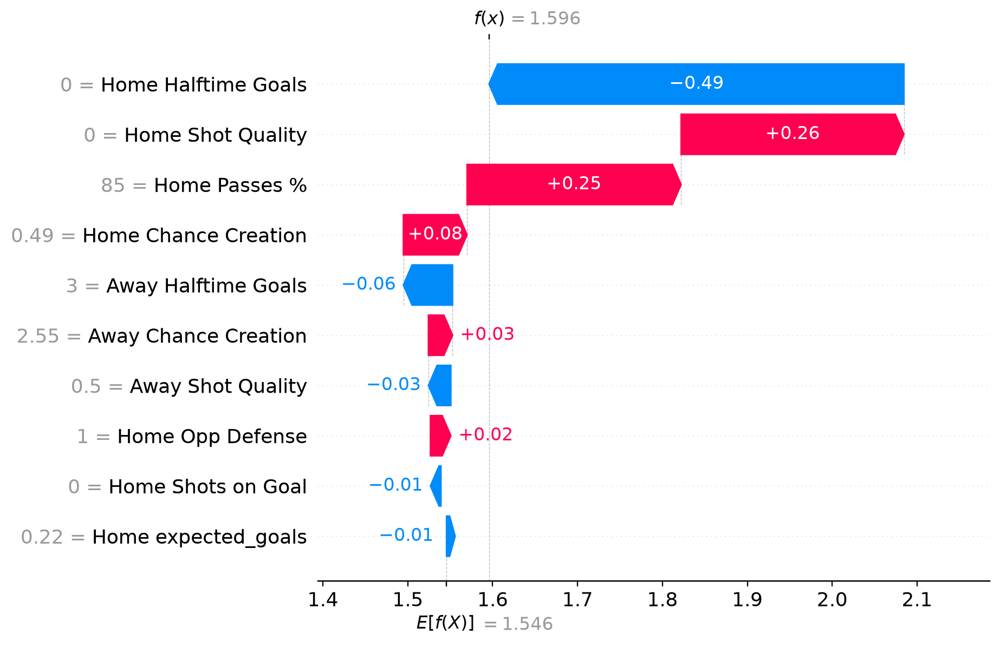
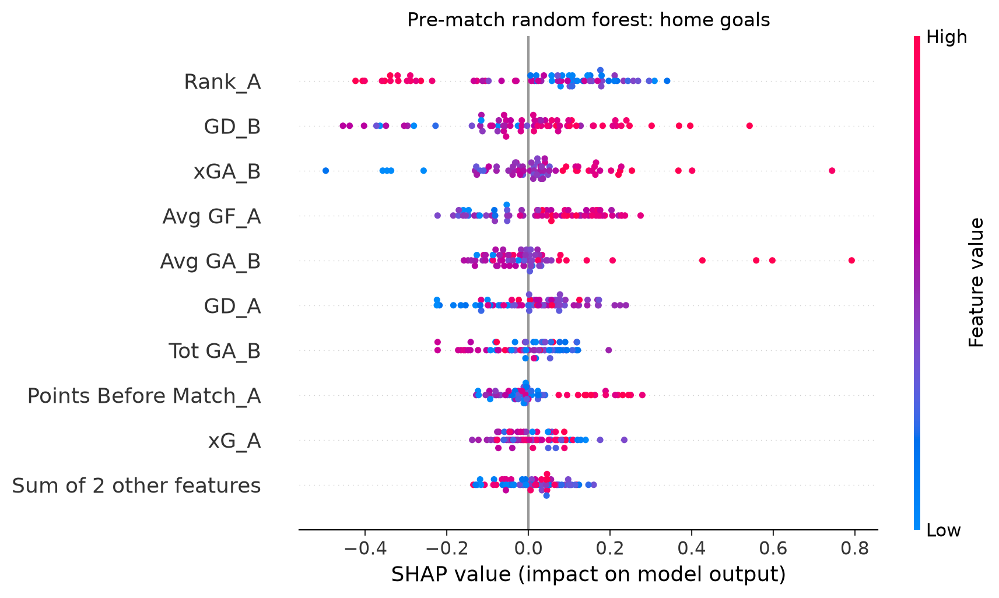

# EPL Goals Model

Predicts how many goals each team scores in a Premier League match, using random forest and XGBoost regressors. Two versions:

- **Pre-match:** uses each team's form and season stats *before* kickoff.
- **Halftime:** uses first-half stats (shots, xG, possession, halftime score) to predict the final score.

A small Gradio app turns the halftime XGBoost predictions into a predicted score and estimated win/draw/loss probabilities.

## Results

2024-25 season, ~340 matches, 80/20 random train/test split (`random_state=42`). RMSE is in goals (lower is better).

| Model | Side | RMSE | Baseline: full-match average | Baseline with halftime score | R² |
|---|---|---|---|---|---|
| Halftime XGBoost | Home | **0.86** | 1.27 | 0.91 | 0.54 |
| Halftime XGBoost | Away | **0.79** | 0.97 | 0.83 | 0.30 |
| Halftime random forest | Home | 0.86 | 1.27 | 0.91 | 0.54 |
| Halftime random forest | Away | 0.84 | 0.97 | 0.83 | 0.21 |
| Pre-match XGBoost | Home | 1.20 | 1.23 | – | 0.04 |
| Pre-match XGBoost | Away | 0.96 | 0.97 | – | 0.01 |
| Pre-match random forest | Home | 1.35 | 1.23 | – | -0.20 |
| Pre-match random forest | Away | 0.96 | 0.97 | – | 0.00 |

**Baselines**
- *Full-match average:* always predict the training set's average final goals (~1.5 home, ~1.4 away), the same number for every match.
- *Baseline with halftime score:* this match's halftime goals + the training set's average second-half goals, so it changes from match to match. This is the fair bar for a halftime model, because it uses the same halftime information with no machine learning.

**What the results say**
- Most of the halftime models' accuracy comes from knowing the halftime score. The models add a small edge (~0.05 goals RMSE) over the halftime-score rule, which may be within noise on a ~68-match test set.
- Pre-match stats alone barely beat (or don't beat) predicting the average. One season isn't enough data; with three seasons the models beat the baseline modestly (see Experiments).

## Experiments

Each comparison scores every version on the same test matches (`src/models/compare_experiments.py`).

**Halftime random forest: all features vs selected features**

| Side | Option 1: all (24 features) | Option 2: selected (15 features) |
|---|---|---|
| Home | 0.851 | 0.863 |
| Away | 0.847 | 0.840 |

RMSE in goals. For Option 2, I removed features that contributed little in the SHAP plots. Accuracy stayed about the same (home slightly worse, away slightly better) with fewer inputs, so the simpler model is used.

**Pre-match: one season vs three seasons of training data**

| Model | Side | 1 season (271 matches) | 3 seasons (1,052 matches) | Baseline: full-match average |
|---|---|---|---|---|
| XGBoost | Home | 1.203 | **1.181** | 1.235 |
| XGBoost | Away | 0.956 | **0.927** | 0.961 |
| Random forest | Home | 1.348 | 1.269 | 1.235 |
| Random forest | Away | 0.957 | 0.944 | 0.961 |

RMSE in goals, Option 2 features, tested on the same 2024-25 matches. Adding the 2022-23 and 2023-24 seasons lowered RMSE for every model, and XGBoost clearly beat the baseline. The random forest's home model improved but still didn't beat the baseline (1.269 vs 1.235). Gains are modest (R² up to 0.08).

## Run it

```bash
git clone https://github.com/<your-username>/epl-goals-model.git
cd epl-goals-model
python3 -m venv .venv
source .venv/bin/activate
pip install -r requirements.txt
```

macOS: XGBoost needs OpenMP. Run `brew install libomp` if `import xgboost` fails.

**Demo app**

```bash
python src/models/halftime_gradient_boosting.py   # trains and saves the models the app loads
python app/simple_ui.py                            # starts the app; open the link it prints (http://127.0.0.1:7860)
```

Upload `data/sample_halftime_input.csv` (a test-set match the models never trained on). The app shows the predicted score, expected goals, estimated win/draw/loss probabilities, and the most likely result. The probabilities come from a Poisson model of each team's second-half goals.

**Reproduce the results**

```bash
for f in src/models/halftime_*.py src/models/prematch_*.py; do python "$f"; done   # results table
python src/models/compare_experiments.py                                              # experiments
```

## Project structure

```
src/data/      data-collection scripts (API-Football, FBref scraping)
src/models/    training scripts: {prematch, halftime} x {random forest, XGBoost}
models/        training outputs: feature column lists (.json) and saved models (.pkl, not committed)
app/           Gradio demo
data/          collected datasets + sample input for the demo
docs/images/   SHAP plots
```

## Data and features

The CSVs are included, so you don't need an API key to train the models. `src/data/` shows how they were collected.

**Halftime models:** first-half team stats from [API-Football](https://www.api-football.com/), 340 matches of the 2024-25 season.

| Feature | Meaning |
|---|---|
| Halftime Goals | Goals scored in the first half |
| Shots on Goal, Total Shots | First-half shots |
| expected_goals | First-half xG: how many goals the chances "should" have produced |
| Ball Possession, Passes % | Share of possession and pass completion |
| Yellow Cards, Red Cards | First-half cards |
| Shot Quality | Shots on goal ÷ (total shots + 1) |
| Chance Creation | Possession share × (shots on goal + 1) |
| Opp Defense | (Halftime goals + 1) ÷ (shots on goal + 1): how often shots on target went in |

Each model uses a subset of these. The app uses the XGBoost models, whose feature lists are saved in `models/`. The random forest scripts list their features in their `df.drop` lines.

**Pre-match models:** each team's season-to-date stats before kickoff, built from scores and xG scraped from [FBref](https://fbref.com/) (`_A` = home team, `_B` = away team).

| Feature | Meaning |
|---|---|
| Rank, Points Before Match | League position and points before this match |
| Tot GF, Tot GA, GD | Total goals for, against, and goal difference |
| Avg GF, Avg GA | Goals for and against per match |
| xG, xGA | Average expected goals created and conceded per match |
| Recent Record | Form over the last five matches |

The home-goals model mostly sees the home team's attack and the away team's defense, and the away-goals model the reverse.

## What drives the predictions

SHAP shows how much each feature pushed a prediction up or down. Each dot is one test match. Dots to the right raised the predicted goals; red means the feature's value was high for that match.

**Halftime random forest:**

<table>
  <tr>
    <td></td>
    <td></td>
  </tr>
</table>

- Halftime goals dominate both models, which matches the halftime-score baseline result.
- After that, the home model leans on pass completion, chance creation, and shot volume; the away model on chance creation and possession.

**One prediction, step by step (halftime XGBoost, the model the app uses, home goals):**



Ipswich vs Nottingham Forest (0–3 at halftime), the demo's sample input: the model starts at the 1.55 average, drops 0.49 because Ipswich hadn't scored by halftime, and rises with their shot quality and 85% passing, ending at 1.60, the expected goals the app shows. Ipswich actually scored 2.

**Pre-match random forest (home goals):**



- A worse league position (high `Rank_A`) lowers predicted home goals, and an opponent that concedes more chances (high `xGA_B`, `Avg GA_B`) raises them.
- These patterns make football sense, but this model doesn't beat the average baseline, so read them as what the model learned, not reliable effects.

More plots (pre-match away and the other waterfalls) are in `docs/images/`.

## Project history

I built this project in spring 2025: collected the data, engineered the halftime features, trained the models, and tested different feature sets and amounts of training data, recording the results in my notes. In 2026 I organized it into this repository:
- The experiments are rebuilt as one script that scores every version on the same test matches against a baseline.
- I added the halftime-score baseline and the win/draw/loss probabilities.
- The feature formulas (shot quality, chance creation, opp defense) come from my original notebook.

## Limitations

- **Small data.** One season, ~340 matches; test sets are ~68 matches, so small differences between models aren't reliable.
- **Random split, not by date.** Training can include matches played after test matches. A chronological split would be stricter.
- **Halftime models use different feature lists.** The random forest's list (15 features) was chosen before the engineered features existed. The XGBoost list (10) was refined afterward and drops raw stats the engineered features already capture, like total shots and possession. So differences between the two models reflect both the algorithm and the inputs.
- **Early-season rank is alphabetical.** On matchday 1 every team has 0 points, so `Rank` reflects alphabetical order for the first few weeks.
- **Halftime data and collection script are out of sync.** The halftime CSV was pulled with the endpoint's first-half option (a paid feature), but the API script in this repo doesn't include that request and returns full-match stats.
- **Probability assumptions.** Win/draw/loss probabilities assume independent Poisson goals, which slightly underestimates draws, and the models were trained on squared error rather than as Poisson models. The probabilities haven't been checked for calibration.

## What I'd do next time

- Test new features (head-to-head history, player availability such as injuries and leading scorers, and team formation) to see how they affect goal predictions. The main constraint is access to this data.
- Use a chronological split or time-series cross-validation, and report variance across folds.
- Switch the main pre-match scripts to the three-season data, since the experiment shows it helps.
- Use one shared feature list for both halftime models.
